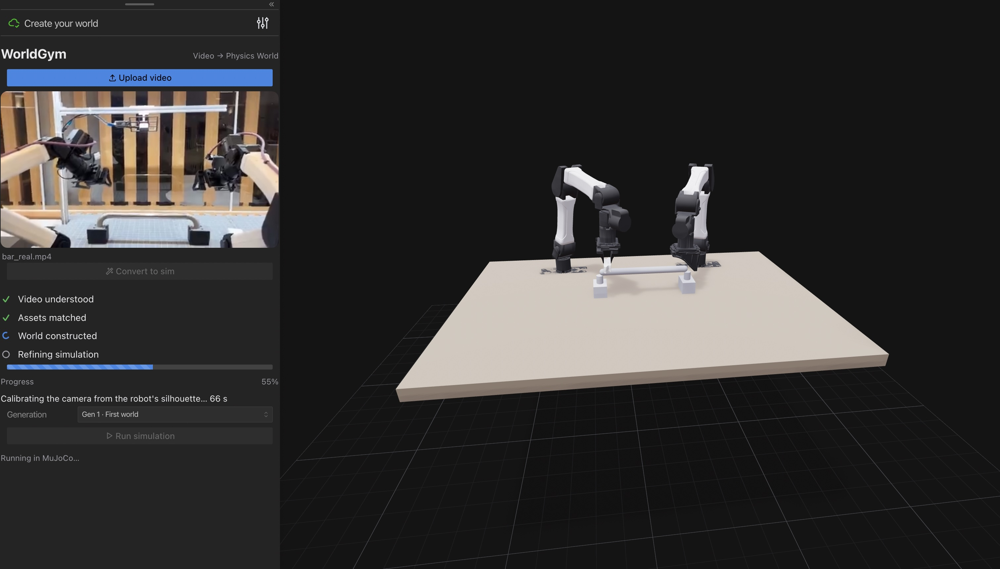
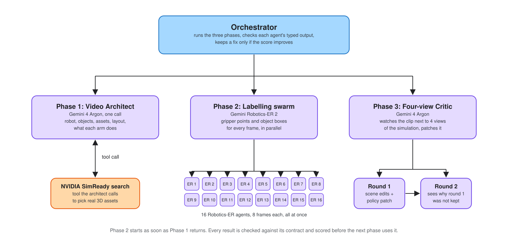
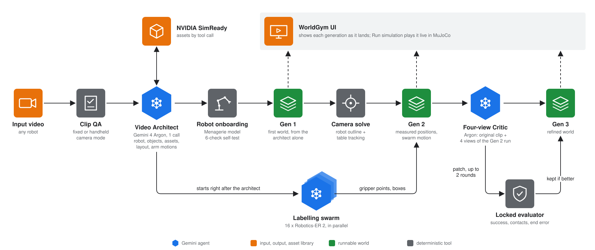

# WorldGym

**Turn any robot video into simulation.**



Gemini 4 Argon watches a robot video, identifies the robot, finds real 3D assets for every object and rebuilds the
scene in MuJoCo with each arm doing what it did. It then watches its own simulation next to the original clip and
fixes what is wrong. Built at the Gemini 4 Argon SF Hackathon (problem statement 2).

## The problem

Teams record a lot of robot video: teleoperation demos, deployment clips, failures. Turning one clip into a
simulation that performs the same action still takes days of manual work. Someone has to rebuild the scene, find
or model the objects, place them, match the camera and script the motion until it looks right.

The task: take a real video of any robot (one or two arms, fixed or handheld camera) and produce an executable
simulation that keeps the exact action. That means the right robot, the right objects in the right places, and
each arm doing what it did: which arm holds, which arm wipes, where it starts and ends, in which direction, how
many passes, and what happens to the object afterwards.

## Agent architecture



| Agent | Model | Input | Output | Judged by |
|---|---|---|---|---|
| Video Architect | Gemini 4 Argon, high thinking, function calling | full clip, 16 keyframes, a sheet of rendered robot models | robot model; every object with its SimReady asset, position, long axis and role; timed phases; one motion entry per arm (start, end, passes, one way or back and forth, put back or not) | Gen 1 runs in physics |
| Labelling swarm | Gemini Robotics-ER 2, 16 agents in parallel | batches of 8 frames, about 125 frames in total | fingertip point, gripper open or holding, object boxes per frame | Gen 2 replay |
| Four-view Critic | Gemini 4 Argon, high thinking, 2 rounds | original clip and a time-aligned 2x2 video of the simulation: overlay on the real frame, top view with a 5 cm grid, side view with 5 cm height lines, collision wireframe | object position, yaw and size edits plus a policy patch, with timestamped observations | locked evaluator: task success, then unwanted contacts, then end-pose error against the video |

Python runs the pipeline. Each agent has a fixed role, a typed output (pydantic) and a number it is judged by.
Motion is written in a small parametric policy language (`hold`, `wipe`, `pick_place`, `sync_after` between arms),
not code, so agents can only change parameters and every proposal can be run and scored.

## Pipeline



Every generation is a complete world. The 3D view always shows the newest one, and Run simulation plays it live
in MuJoCo in real time.

Results from a live run on a 36 s handheld clip of two i2rt YAM arms wiping a steel bar (cache off):

| Step | Result |
|---|---|
| Video Architect | i2rt YAM bimanual, bar, SimReady sponge `cleaning_sponge_g01`, 11 phases |
| Gen 1 | 43 % of the bar wiped, 3 unwanted contacts |
| Camera solve | robot outline IoU 0.78, 105 of 133 frames tracked |
| Gen 2 | 70 % wiped, task check passes, 1 unwanted contact |
| Gen 3 | end-pose error 339 mm to 165 mm, 84 % wiped, 12 arm-to-arm contacts (the score now counts contacts) |

Every run and what we learned on the way is in [docs/PROGRESS.md](docs/PROGRESS.md).

## Run it

```bash
uv sync
scripts/setup_assets.sh          # MuJoCo Menagerie robots
cp .env.example .env             # add your Gemini API key
uv run python -m app.demo        # open http://localhost:8080
```

## References

- [MuJoCo](https://github.com/google-deepmind/mujoco)
- [MuJoCo Menagerie](https://github.com/google-deepmind/mujoco_menagerie)
- [NVIDIA SimReady Central](https://huggingface.co/spaces/nvidia/simready-central) and [nvidia/simready-assets](https://huggingface.co/datasets/nvidia/simready-assets) (CC-BY 4.0)
- [OpenUSD](https://openusd.org)
- [Viser](https://github.com/nerfstudio-project/viser)
- Gemini 4 Argon, Gemini Robotics-ER 2 and Antigravity Managed Agents (Gemini Interactions API)
- RoboSimStudio, UC Berkeley and NVIDIA, arXiv:2610.18835
